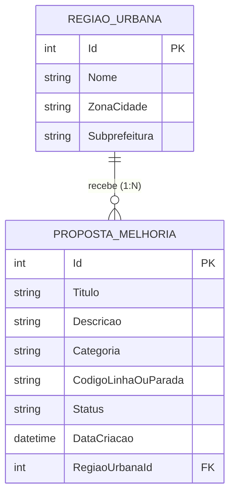

# Via Cidadã — API de Ouvidoria e Mobilidade Urbana (.NET 8)

> **Disciplina:** Advanced Business Development with .NET | **Tema:** CitizenTech — Mobilidade Urbana Acessível e Participação Cidadã

API REST em **ASP.NET Core 8 (Web API)** desenvolvida para sustentar o módulo de **Ouvidoria e Participação Cidadã** da solução **Via Cidadã**. A aplicação permite cadastrar regiões urbanas/subprefeituras e receber manifestações e propostas de melhoria de mobilidade e acessibilidade no transporte público (como iluminação de paradas, instalação de piso tátil, abrigos e revisão de intervalos de linhas), utilizando **Controllers**, **Entity Framework Core 8** e **Oracle Database** (`Oracle.EntityFrameworkCore`) com **Migrations** versionadas.

---

## 1. Integrantes, Vídeo e Conexão CitizenTech / ODS da ONU

### Integrantes do Grupo

| Nome Completo | RM | Turma |
|---|---|---|
| Alisson Kawan Evangelista Silva | 567598 | 2TDS |
| Kenji Fernandes Wakabayashi | 568156 | 2TDS |
| Erick Ramos Santos | 567837 | 2TDS |
| Eduardo Boni dos Santos | 567236 | 2TDS |
| Marcos Vinicius de Jesus Almeida | 567214 | 2TDS |

### Vídeo de Demonstração (até 5 minutos)
- **Link do Vídeo no YouTube (Público / Não Listado):** *(Inserir link após gravação demonstrando o CRUD e as tabelas no Oracle)*

### O Problema, o Cidadão Beneficiado e os ODS da ONU
- **Cidadão Beneficiado:** Passageiros do transporte público metropolitano, especialmente **Pessoas com Deficiência (PcD)**, idosos e cidadãos com mobilidade reduzida que convivem com barreiras físicas e falta de infraestrutura nas paradas e linhas de ônibus.
- **Problema Resolvido:** Ausência de um canal estruturado e geolocalizado por região/subprefeitura para registrar, priorizar e acompanhar propostas de melhoria de infraestrutura e acessibilidade urbana.
- **Conexão com os ODS da Agenda 2030 (ONU):**
  - **ODS 10 — Redução das Desigualdades:** Promove inclusão e voz ativa para cidadãos com mobilidade reduzida na priorização de melhorias do transporte coletivo.
  - **ODS 11 — Cidades e Comunidades Sustentáveis (Meta 11.2):** Apoia a gestão participativa e a melhoria contínua de sistemas de transporte seguros, acessíveis e sustentáveis.

---

## 2. Modelo de Dados e Relacionamento (1:N)

Uma região urbana (`RegiaoUrbana`) pode estar associada a várias propostas de melhoria (`PropostaMelhoria`); cada proposta pertence obrigatoriamente a uma região urbana (`1:N`).



As tabelas geradas pelas Migrations no Oracle da FIAP são:
- `TB_VC_NET_REGIOES`
- `TB_VC_NET_PROPOSTAS`
- `__EFMigrationsHistory` (controle de versão do EF Core)

---

## 3. Pré-requisitos e Configuração de Ambiente (Oracle FIAP)

- **.NET SDK 8.0**
- **Acesso ao banco Oracle da FIAP** (`oracle.fiap.com.br:1521/ORCL`)
- **Ferramenta CLI do Entity Framework Core 8:**
  ```powershell
  dotnet tool install --global dotnet-ef --version 8.0.*
  ```

> **Segurança:** Nenhuma senha é versionada no `appsettings.json` nem no repositório. Você pode configurar as credenciais usando **arquivo `.env`** (mesmo padrão da API Java) ou **`dotnet user-secrets`**.

### Opção A — Usando arquivo `.env` e script PowerShell (Recomendado)

1. Copie o arquivo [`.env.example`](.env.example) para `.env` na raiz do projeto (o arquivo `.env` já está no `.gitignore`) e preencha `ORACLE_DB_USERNAME` e `ORACLE_DB_PASSWORD`.
2. O `Program.cs` lê automaticamente o arquivo `.env` local ao iniciar. Para comandos do `dotnet ef` no terminal, carregue as variáveis na sessão atual com:

```powershell
. .\scripts\load-env.ps1
```

### Opção B — Usando `dotnet user-secrets`

Execute os comandos abaixo na pasta raiz do projeto, substituindo `SEU_RM` e `SUA_SENHA` pelas suas credenciais:

```powershell
dotnet user-secrets init
dotnet user-secrets set "ConnectionStrings:OracleConnection" "Data Source=(DESCRIPTION=(ADDRESS=(PROTOCOL=TCP)(HOST=oracle.fiap.com.br)(PORT=1521))(CONNECT_DATA=(SID=ORCL)));User Id=SEU_RM;Password=SUA_SENHA;"
```

---

## 4. Como Aplicar as Migrations e Executar a API

Com as variáveis configuradas (via `.env` ou `user-secrets`), execute na raiz do projeto:

```powershell
# 1. Carregar variáveis de ambiente na sessão (se usar .env)
. .\scripts\load-env.ps1

# 2. Aplicar as Migrations no Oracle da FIAP
dotnet ef database update

# 3. Compilar e iniciar a API
dotnet run
```

O endereço de escuta (ex.: `http://localhost:5190` ou `https://localhost:7124`) será exibido no terminal pelo `dotnet run`. A migration inicial encontra-se em [`Migrations/20261117065616_InitialCreate.cs`](Migrations/20261117065616_InitialCreate.cs).

---

## 5. Recursos, Rotas CRUD e Como Testar

O atributo `[ApiController]` realiza a validação automática das `DataAnnotations` e retorna `400 Bad Request` em JSON quando os dados de entrada são inválidos. Os exemplos abaixo utilizam `Content-Type: application/json` (substitua `https://localhost:7xxx` pela porta exibida no seu terminal).

### 5.1. Regiões Urbanas (`/api/regioes`)

| Método e Rota | Sucesso | Erros Tratados (JSON) |
|---|---|---|
| `GET /api/regioes` | `200 OK` com lista | — |
| `GET /api/regioes/{id}` | `200 OK` com região | `404 Not Found` se não existir |
| `POST /api/regioes` | `201 Created` com `Location` e entidade | `400 Bad Request` se dados inválidos |
| `PUT /api/regioes/{id}` | `204 No Content` | `400 Bad Request` se inválido; `404 Not Found` se não existir |
| `DELETE /api/regioes/{id}` | `204 No Content` | `404 Not Found` se não existir |

#### Criar região — `POST /api/regioes`

```bash
curl -X POST "https://localhost:7xxx/api/regioes" \
  -H "Content-Type: application/json" \
  -d '{"nome":"Centro Histórico","zonaCidade":"Centro","subprefeitura":"Sé"}'
```

Resposta `201 Created` inclui o recurso criado e cabeçalho `Location` apontando para `GET /api/regioes/{id}`.

#### Listar e consultar região por ID — `GET /api/regioes` e `GET /api/regioes/1`

```bash
curl "https://localhost:7xxx/api/regioes"
curl "https://localhost:7xxx/api/regioes/1"
```

Exemplo de retorno (`200 OK`):

```json
{
  "id": 1,
  "nome": "Centro Histórico",
  "zonaCidade": "Centro",
  "subprefeitura": "Sé"
}
```

#### Atualizar região — `PUT /api/regioes/1`

```bash
curl -i -X PUT "https://localhost:7xxx/api/regioes/1" \
  -H "Content-Type: application/json" \
  -d '{"nome":"Centro Expandido","zonaCidade":"Centro","subprefeitura":"Sé"}'
```

Resposta: `204 No Content`.

#### Excluir região — `DELETE /api/regioes/1`

```bash
curl -i -X DELETE "https://localhost:7xxx/api/regioes/1"
```

Resposta: `204 No Content` se removida, ou `404 Not Found` com `{"mensagem":"Região urbana com ID 999 não encontrada."}`. A exclusão da região remove também suas propostas dependentes por cascata (`DeleteBehavior.Cascade`).

---

### 5.2. Propostas de Melhoria (`/api/propostas`)

| Método e Rota | Sucesso | Erros Tratados (JSON) |
|---|---|---|
| `GET /api/propostas` | `200 OK` com lista | — |
| `GET /api/propostas/{id}` | `200 OK` com proposta | `404 Not Found` se não existir |
| `POST /api/propostas` | `201 Created` com `Location` e entidade | `400 Bad Request` se dados inválidos ou região inexistente |
| `PUT /api/propostas/{id}` | `204 No Content` | `400 Bad Request` se inválido ou região inexistente; `404 Not Found` se proposta não existir |
| `DELETE /api/propostas/{id}` | `204 No Content` | `404 Not Found` se não existir |

#### Criar proposta — `POST /api/propostas`

`DataCriacao` é definida automaticamente pela API em UTC e `Status` assume `"RECEBIDA"` por padrão:

```bash
curl -X POST "https://localhost:7xxx/api/propostas" \
  -H "Content-Type: application/json" \
  -d '{"titulo":"Melhorar iluminação do ponto","descricao":"Solicito iluminação adequada no ponto da Avenida Central para aumentar a segurança dos passageiros à noite.","categoria":"SEGURANCA","codigoLinhaOuParada":"P-204","regiaoUrbanaId":1}'
```

#### Listar e consultar proposta por ID — `GET /api/propostas` e `GET /api/propostas/1`

```bash
curl "https://localhost:7xxx/api/propostas"
curl "https://localhost:7xxx/api/propostas/1"
```

Exemplo de retorno (`200 OK`):

```json
{
  "id": 1,
  "titulo": "Melhorar iluminação do ponto",
  "descricao": "Solicito iluminação adequada no ponto da Avenida Central para aumentar a segurança dos passageiros à noite.",
  "categoria": "SEGURANCA",
  "codigoLinhaOuParada": "P-204",
  "status": "RECEBIDA",
  "dataCriacao": "2026-11-17T23:30:00Z",
  "regiaoUrbanaId": 1
}
```

#### Atualizar proposta — `PUT /api/propostas/1`

```bash
curl -i -X PUT "https://localhost:7xxx/api/propostas/1" \
  -H "Content-Type: application/json" \
  -d '{"titulo":"Iluminação e abrigo no ponto","descricao":"Solicito melhorias na iluminação e instalação de abrigo no ponto da Avenida Central para proteger passageiros.","categoria":"INFRAESTRUTURA","codigoLinhaOuParada":"P-204","status":"EM_ANALISE","regiaoUrbanaId":1}'
```

Resposta: `204 No Content` (preservando a `DataCriacao` original).

#### Excluir proposta — `DELETE /api/propostas/1`

```bash
curl -i -X DELETE "https://localhost:7xxx/api/propostas/1"
```

Resposta: `204 No Content`.

---

## 6. Demonstração de Validação e Tratamento de Erros (`400` e `404`)

### 6.1. Erro `400 Bad Request` — Validação de Dados de Entrada (DataAnnotations)

Título com menos de 5 caracteres:

```bash
curl -i -X POST "https://localhost:7xxx/api/propostas" \
  -H "Content-Type: application/json" \
  -d '{"titulo":"Oi","descricao":"Descrição suficientemente longa para cumprir a validação.","categoria":"MOBILIDADE","regiaoUrbanaId":1}'
```

Retorna `400 Bad Request` em JSON (`ValidationProblemDetails`) detalhando o campo inválido e a mensagem configurada na entidade.

### 6.2. Erro `400 Bad Request` — Chave Estrangeira / Região Urbana Inexistente

```bash
curl -i -X POST "https://localhost:7xxx/api/propostas" \
  -H "Content-Type: application/json" \
  -d '{"titulo":"Ajustar intervalo da linha","descricao":"Solicito revisão do intervalo da linha nos horários de pico.","categoria":"TRANSPORTE","regiaoUrbanaId":999999}'
```

Retorna `400 Bad Request` com JSON:
```json
{"mensagem": "A região urbana com ID 999999 não existe."}
```

### 6.3. Erro `404 Not Found` — ID Inexistente

```bash
curl -i "https://localhost:7xxx/api/regioes/999999"
curl -i "https://localhost:7xxx/api/propostas/999999"
curl -i -X DELETE "https://localhost:7xxx/api/regioes/999999"
```

Retorna `404 Not Found` com JSON:
- Região: `{"mensagem": "Região urbana com ID 999999 não encontrada."}`
- Proposta: `{"mensagem": "Proposta de melhoria com ID 999999 não encontrada."}`

---

## 7. Repositórios Relacionados do Ecossistema ViaCidadã (GS)

- [gs-dotnet-api](https://github.com/GS-EDUeAMIGOS/gs-dotnet-api) — Advanced Business Development with .NET
- [gs-java-api](https://github.com/GS-EDUeAMIGOS/gs-java-api) — Java Advanced
- [gs-mobile](https://github.com/GS-EDUeAMIGOS/gs-mobile) — Mobile Application Development (Flutter)
- [gs-database](https://github.com/GS-EDUeAMIGOS/gs-database) — Mastering Relational and Non-Relational Database

---

## 8. Declaração de Uso de IA Generativa

Em conformidade com as diretrizes acadêmicas da **Global Solution FIAP 2026/2**, declaramos de forma transparente como ferramentas de Inteligência Artificial Generativa foram utilizadas no desenvolvimento deste projeto:

1. **Planejamento e Modelagem guiados por Engenharia de Software:**
   - Utilizamos princípios de Engenharia de Software (modelagem relacional `1:N`, integridade referencial, semântica de verbos e códigos de status HTTP em APIs RESTful e validação de dados de entrada com DataAnnotations) para estruturar a solução.
2. **Apoio Produtivo e Revisão Documental:**
   - Ferramentas de IA generativa foram utilizadas como apoio para revisão de texto da documentação (`README.md`), padronização de scripts de variáveis de ambiente (`.env.example` / `load-env.ps1`) e conferência de boas práticas do Entity Framework Core 8 com Oracle.
3. **Compreensão e Responsabilidade Técnica da Equipe:**
   - **Nenhum código ou texto foi entregue sem entendimento e revisão.** Todas as entidades, migrations, contexto de banco de dados (`AppDbContext`) e rotas dos controllers foram revisados, compilados e validados pelos integrantes do grupo, que detêm total domínio sobre o funcionamento da API.
