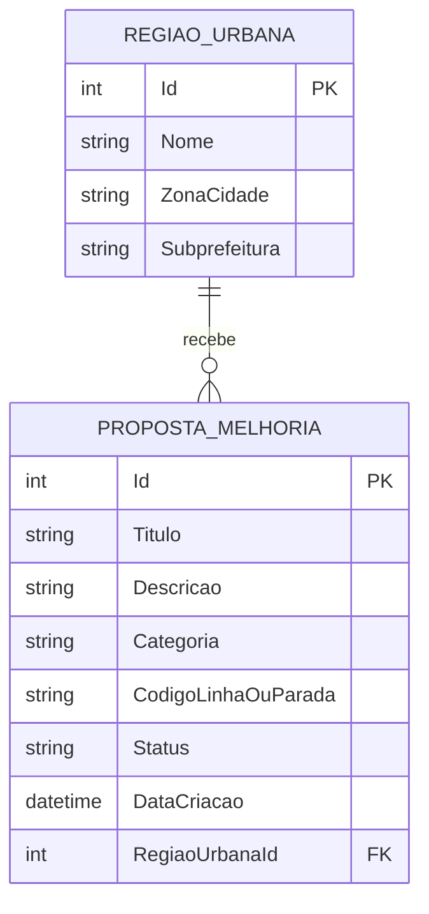

# Via Cidadã — API de Ouvidoria e Mobilidade Urbana

API REST em ASP.NET Core 8 para receber manifestações e propostas de melhoria de mobilidade urbana, organizadas por região. A aplicação usa controllers, Entity Framework Core 8 e Oracle Database por meio de `Oracle.EntityFrameworkCore`.

## Integrantes

| Nome | RM |Truma   |
|---|---|---|
| Alisson Kawan Evangelista Silva | 567598 |  2TDS |
| Kenji Fernandes Wakabayashi | 568156| 2TDS  |
| Erick Ramos Santos | 567837 |  2TDS |
|Eduardo Boni dos Santos| 567236| 2TDS|
| Marcos Vinicius de Jesus Almeida|567214|2TDS |

## Relacionamento

Uma região urbana pode estar associada a várias propostas; cada proposta pertence a uma região urbana.



As tabelas Oracle são `TB_VC_NET_REGIOES` e `TB_VC_NET_PROPOSTAS`.

## Pré-requisitos

- .NET SDK 8.0
- Acesso ao Oracle informado na connection string
- Ferramenta Entity Framework: `dotnet tool install --global dotnet-ef --version 8.0.*` (se ainda não estiver instalada)

Execute os comandos abaixo na pasta raiz do projeto. Substitua os placeholders pelas suas próprias credenciais; não as grave ou versione no `appsettings.json`.

```bash
dotnet user-secrets init
dotnet user-secrets set "ConnectionStrings:OracleConnection" "Data Source=(DESCRIPTION=(ADDRESS=(PROTOCOL=TCP)(HOST=oracle.fiap.com.br)(PORT=1521))(CONNECT_DATA=(SID=ORCL)));User Id=SEU_RM;Password=SUA_SENHA;"
```

Substitua `SEU_RM` e `SUA_SENHA` pelos valores reais somente no comando executado localmente. Em shell Unix pode-se evitar deixar senha no histórico usando o mecanismo de entrada segura do shell; jamais publique a connection string.

Crie/atualize o schema conforme a migration e inicie a API:

```bash
dotnet ef database update
dotnet run
```

O endereço de escuta é exibido no terminal pelo `dotnet run`. A migration inicial está em `Migrations/<timestamp>_InitialCreate.cs`, junto ao snapshot do modelo.

## Recursos e rotas

`[ApiController]` faz a validação das DataAnnotations e responde `400 Bad Request` automaticamente quando o payload é inválido. Os corpos abaixo são JSON (`Content-Type: application/json`). Exemplos assumem que a API está em `https://localhost:7xxx`; troque pela URL local apresentada no terminal.

### Regiões

| Método e rota | Sucesso | Erros principais |
|---|---|---|
| `GET /api/regioes` | `200` com lista | — |
| `GET /api/regioes/{id}` | `200` com região | `404` JSON se não existir |
| `POST /api/regioes` | `201` com `Location` e entidade | `400` JSON se inválido |
| `PUT /api/regioes/{id}` | `204` | `400` inválido; `404` JSON se não existir |
| `DELETE /api/regioes/{id}` | `204` | `404` JSON se não existir |

#### Criar região — POST `/api/regioes`

```bash
curl -X POST "https://localhost:7xxx/api/regioes" -H "Content-Type: application/json" -d '{"nome":"Centro Histórico","zonaCidade":"Centro","subprefeitura":"Sé"}'
```

Resposta `201 Created` inclui o recurso criado e cabeçalho `Location` para `GET /api/regioes/{id}`.

#### Listar e consultar região — GET `/api/regioes` e `/api/regioes/1`

```bash
curl "https://localhost:7xxx/api/regioes"
curl "https://localhost:7xxx/api/regioes/1"
```

Formato ilustrativo da entidade:

```json
{"id":1,"nome":"Centro Histórico","zonaCidade":"Centro","subprefeitura":"Sé"}
```

#### Atualizar região — PUT `/api/regioes/1`

O ID da rota determina a entidade atualizada.

```bash
curl -X PUT "https://localhost:7xxx/api/regioes/1" -H "Content-Type: application/json" -d '{"nome":"Centro Expandido","zonaCidade":"Centro","subprefeitura":"Sé"}'
```

Resposta `204 No Content`.

#### Excluir região — DELETE `/api/regioes/1`

```bash
curl -i -X DELETE "https://localhost:7xxx/api/regioes/1"
```

Resposta `204 No Content` se removida. Se o ID não existir, a API responde `404` com `{"mensagem":"Região urbana com ID 999 não encontrada."}`. A exclusão da região remove também suas propostas dependentes por cascata para manter a integridade referencial.

### Propostas

| Método e rota | Sucesso | Erros principais |
|---|---|---|
| `GET /api/propostas` | `200` com lista | — |
| `GET /api/propostas/{id}` | `200` com proposta | `404` JSON se não existir |
| `POST /api/propostas` | `201` com `Location` e entidade | `400` se dados inválidos ou região inexistente |
| `PUT /api/propostas/{id}` | `204` | `400` se inválido ou região inexistente; `404` se proposta não existir |
| `DELETE /api/propostas/{id}` | `204` | `404` JSON se não existir |

#### Criar proposta — POST `/api/propostas`

`DataCriacao` é definida pela API em UTC. `Status` usa `RECEBIDA` como valor padrão.

```bash
curl -X POST "https://localhost:7xxx/api/propostas" -H "Content-Type: application/json" -d '{"titulo":"Melhorar iluminação do ponto","descricao":"Solicito iluminação adequada no ponto da Avenida Central para aumentar a segurança dos passageiros à noite.","categoria":"SEGURANCA","codigoLinhaOuParada":"P-204","regiaoUrbanaId":1}'
```

#### Listar e consultar proposta — GET `/api/propostas` e `/api/propostas/1`

```bash
curl "https://localhost:7xxx/api/propostas"
curl "https://localhost:7xxx/api/propostas/1"
```

Formato ilustrativo de retorno:

```json
{"id":1,"titulo":"Melhorar iluminação do ponto","descricao":"Solicito iluminação adequada no ponto da Avenida Central para aumentar a segurança dos passageiros à noite.","categoria":"SEGURANCA","codigoLinhaOuParada":"P-204","status":"RECEBIDA","dataCriacao":"2026-01-15T12:30:00Z","regiaoUrbanaId":1}
```

#### Atualizar proposta — PUT `/api/propostas/1`

```bash
curl -X PUT "https://localhost:7xxx/api/propostas/1" -H "Content-Type: application/json" -d '{"titulo":"Iluminação e abrigo no ponto","descricao":"Solicito melhorias na iluminação e instalação de abrigo no ponto da Avenida Central para proteger passageiros.","categoria":"INFRAESTRUTURA","codigoLinhaOuParada":"P-204","status":"EM_ANALISE","regiaoUrbanaId":1}'
```

Resposta `204 No Content`. A data original de criação é preservada.

#### Excluir proposta — DELETE `/api/propostas/1`

```bash
curl -i -X DELETE "https://localhost:7xxx/api/propostas/1"
```

Resposta `204 No Content` se removida.

## Exemplos de erros

### 400 — validação automática

Título abaixo do mínimo permitido:

```bash
curl -i -X POST "https://localhost:7xxx/api/propostas" -H "Content-Type: application/json" -d '{"titulo":"Oi","descricao":"Descrição suficientemente longa para cumprir a validação.","categoria":"MOBILIDADE","regiaoUrbanaId":1}'
```

O ASP.NET Core retorna `400` com `ValidationProblemDetails`, incluindo os erros e nomes dos campos.

### 400 — região inexistente

```bash
curl -i -X POST "https://localhost:7xxx/api/propostas" -H "Content-Type: application/json" -d '{"titulo":"Ajustar intervalo da linha","descricao":"Solicito revisão do intervalo da linha nos horários de pico.","categoria":"TRANSPORTE","regiaoUrbanaId":999999}'
```

Resposta: `{"mensagem":"A região urbana com ID 999999 não existe."}`. O mesmo tipo de verificação é feito no `PUT` de propostas.

### 404 — recurso inexistente

```bash
curl -i "https://localhost:7xxx/api/regioes/999999"
curl -i "https://localhost:7xxx/api/propostas/999999"
curl -i -X DELETE "https://localhost:7xxx/api/regioes/999999"
curl -i -X PUT "https://localhost:7xxx/api/propostas/999999" -H "Content-Type: application/json" -d '{"titulo":"Ajustar intervalo da linha","descricao":"Solicito revisão do intervalo da linha nos horários de pico.","categoria":"TRANSPORTE","regiaoUrbanaId":1}'
```

Resposta de região: `{"mensagem":"Região urbana com ID 999999 não encontrada."}`. Resposta de proposta: `{"mensagem":"Proposta de melhoria com ID 999999 não encontrada."}`.
